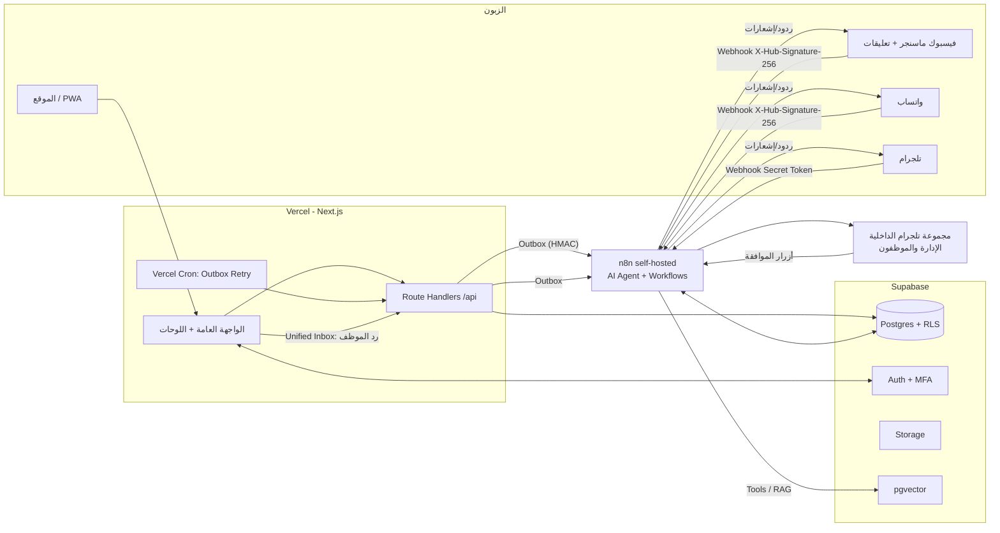

# المعمارية وبنية المجلدات

## 1. المكوّنات



**مبدأ أساسي:** Supabase هو مصدر الحقيقة الوحيد. n8n لا يحتفظ بحالة دائمة، وكل ما يمرّ عبره يُحفظ في Supabase أولاً.

## 2. بنية المجلدات المقترحة

```
alassar-furniture/
├─ CLAUDE.md
├─ docs/                      # PRD, schema, workflows, roadmap, deployment ...
├─ n8n/                       # تصدير JSON لكل Workflow (بدون credentials)
│  ├─ wf-01-chat-inbound.json ...
│  └─ README.md
├─ supabase/
│  ├─ migrations/             # المصدر الوحيد لتغييرات DB
│  ├─ seed.sql                # بيانات تجريبية فقط (placeholders)
│  ├─ tests/                  # pgTAP: اختبارات RLS لكل دور
│  └─ config.toml
├─ public/                    # manifest.webmanifest, أيقونات PWA
├─ src/
│  ├─ app/                    # Next.js App Router
│  │  ├─ (public)/            # الرئيسية، الأقسام، المنتج، السلة، الفروع، السياسات...
│  │  ├─ (auth)/login/        # دخول بالجوال + OTP
│  │  ├─ account/             # لوحة الزبون
│  │  ├─ dashboard/           # لوحات الموظفين (مفصولة بالدور)
│  │  │  ├─ catalog/          # Moderator+Admin
│  │  │  ├─ inbox/            # Moderator+Admin
│  │  │  ├─ posts/            # تجهيز المنشورات
│  │  │  ├─ orders/           # Admin
│  │  │  ├─ stats/            # Admin
│  │  │  ├─ settings/         # Admin
│  │  │  ├─ users/            # Admin
│  │  │  └─ audit/            # Admin + Auditor
│  │  └─ api/
│  │     ├─ orders/ ...       # إنشاء الطلب، رفع الإيصال (signed URL)
│  │     ├─ chat/             # بوابة شات الموقع
│  │     ├─ hooks/n8n/        # استقبال Webhooks موقّعة من n8n
│  │     └─ cron/outbox/      # إعادة محاولة الإرسال
│  ├─ components/ui/          # مكوّنات خفيفة مبنية على Design Tokens
│  ├─ lib/
│  │  ├─ supabase/            # client / server / admin (service_role للخادم فقط)
│  │  ├─ hmac.ts              # توقيع/تحقق Webhooks
│  │  ├─ outbox.ts            # كتابة أحداث الإرسال
│  │  ├─ rate-limit.ts
│  │  ├─ settings.ts          # قراءة إعدادات المتجر/الثيم (مخزّنة مؤقتاً)
│  │  └─ storage.ts           # مسار رفع الصور (نقطة تمديد لضغط WebP لاحقاً)
│  ├─ styles/tokens.css       # Design Tokens (مصدر واحد للألوان/الخطوط/المسافات)
│  └─ types/                  # أنواع مولّدة من Supabase
├─ tests/                     # unit (Vitest) + e2e (Playwright)
├─ .env.example
└─ package.json
```

**نقطة تمديد الصور:** كل الرفع يمر عبر `lib/storage.ts` → `uploadImage(file, kind)`. اليوم يرفع الأصل كما هو؛ في المرحلة 4 تُضاف خطوة ضغط WebP + لوجو داخل الدالة نفسها (أو Edge Function) دون لمس باقي النظام. جدول `product_images` يحتفظ بـ `path` + `variants jsonb` (مقاسات مولّدة لاحقاً).

## 3. تدفق البيانات

### أ) طلب من الموقع
1. الزبون يملأ السلة ويختار الفرع وطريقة الدفع ويوافق على سياسة الاستبدال.
2. `POST /api/orders` → RPC `create_order()` (security definer) تتحقق من الأسعار/المخزون من DB (لا تثق بالعميل) وتنشئ الطلب + البنود + سجل الحالة + `outbox_events(order.created)` في **معاملة واحدة**.
3. الموقع يعيد رابط رفع موقّع لإيصال التحويل (Bucket خاص). عند الرفع تُنشأ `payments(status=pending)` وحدث `payment.receipt_uploaded`.
4. Vercel Cron (كل دقيقة) + محاولة فورية يرسلون أحداث الـ Outbox إلى n8n (HMAC). النجاح ← `sent`، الفشل ← `attempts+1` مع backoff أسّي.
5. n8n (WF-03) يُشعر مجموعة تلجرام الداخلية بالطلب/الإيصال.
6. الإداري يؤكد/يرفض الدفعة من اللوحة ← تغيير الحالة (مسجّل في Audit Log) ← حدث `order.status_changed` ← n8n (WF-07) يرسل للزبون على قناته الأصلية (`orders.source_channel`).

### ب) رسالة من قناة (فيسبوك/واتساب/تلجرام)
1. المنصة ترسل Webhook إلى n8n مباشرة (رابط ثابت). n8n يتحقق من التوقيع، ويرفض غير الموقّع.
2. n8n يمنع التكرار (`processed_webhook_events`)، ويحلّ هوية الزبون (`resolve_customer`: رقم الجوال أو معرّف القناة ← `customers`).
3. يحفظ الرسالة في `messages` ويفتح/يحدّث `conversations`.
4. إذا `conversations.status = 'human'` ← لا يرد البوت، ويُنبَّه الموظفون فقط. غير ذلك ← AI Agent يجيب عبر Tools على Supabase فقط.
5. الرد يُحفظ في `messages` ثم يُرسل على نفس القناة (واتساب خارج 24 ساعة ← Template).

### ج) التحويل لموظف
Agent يستدعي أداة `handoff` ← `conversations.status='human'` (أو `waiting` خارج الدوام مع `waiting_since`) ← إشعار تلجرام للمجموعة الداخلية ← الموظف يرد من **Unified Inbox** ← `POST /api/inbox/reply` يكتب في `messages` + Outbox ← n8n (WF-06) يرسله على قناة الزبون ← زر "إعادة للبوت" يعيد `status='bot'`.

### د) المنشورات بالموافقة
إضافة منتج/عرض (أو طلب من المشرف) ← `social_posts(status=draft)` + حدث ← n8n (WF-08) يولّد النص بالـ AI ← تلجرام للإداري (✅ ✏️ ❌) ← حسب القرار ينشر على فيسبوك (+ قناة تلجرام) ويحفظ `fb_post_url`.

### هـ) الموثوقية
- **Outbox pattern:** لا يُرسل شيء لـ n8n قبل حفظه. توقف n8n لا يضيع شيئاً؛ الأحداث تبقى `pending` وتُعاد.
- **Idempotency:** لكل حدث `idempotency_key`، وn8n يتجاهل المكرر.
- **Dead letter:** بعد N محاولات تصبح `dead` وتظهر للإداري في اللوحة + تنبيه.
- **الرسائل الواردة:** إن تعطل n8n، منصات Meta/تلجرام تعيد المحاولة لفترة؛ وللمزيد من الأمان يُقترح (قرار معلّق) Edge Function خفيفة كمستقبِل أول تحفظ الخام في DB ثم تمرّر لـ n8n.

## 4. الأمان على الحدود
| الحد | الآلية |
|---|---|
| الموقع → n8n | HMAC-SHA256 على الجسم + `X-Timestamp` (نافذة 5 دقائق) + `X-Idempotency-Key` |
| n8n → الموقع | نفس الآلية بمفتاح مختلف (`N8N_INBOUND_HMAC_SECRET`) |
| Meta → n8n | `X-Hub-Signature-256` بـ App Secret + `hub.verify_token` للتحقق الأولي |
| تلجرام → n8n | `X-Telegram-Bot-Api-Secret-Token` |
| n8n → Supabase | `service_role` من credentials في n8n فقط |
| المتصفح → Supabase | anon key + JWT + RLS |
| Rate limiting | جدول `rate_limit_hits` + دالة `check_rate_limit(key, limit, window)` على `/api/chat` ونماذج الطلب |
